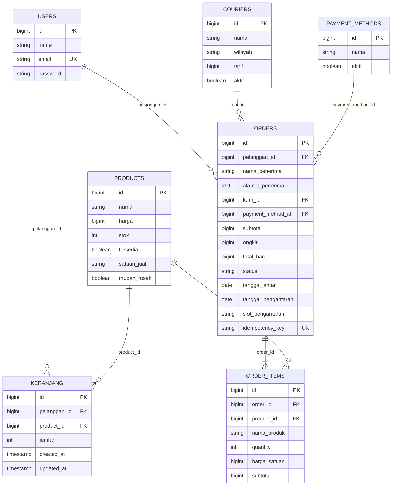

# ERD Transaksi TokoTani — Keranjang, Kurir/Wilayah Antar, Pesanan, Detail Pesanan

Dokumen ini menjelaskan rancangan, alur, dan detail implementasi objektif transaksi
pada backend TokoTani. Fokus objektif ini adalah:

1. Rancangan ERD transaksi dan foreign key ke `products` serta pelanggan.
2. Migration dan model untuk `keranjang`, `kurir`/`wilayah_antar`, `pesanan`, dan
   `detail_pesanan`.
3. Endpoint `GET/POST/PUT/DELETE /api/keranjang` yang persisten di server.
4. Penggabungan jumlah ketika produk yang sama ditambahkan lagi ke keranjang.
5. Endpoint `GET /api/kurir` dengan minimal tiga pilihan tarif berbeda.
6. Relasi snapshot `detail_pesanan` (`nama_produk` dan `harga_satuan`).

---

## 1. Keputusan Desain Penting

### 1.1 Tidak membuat duplikasi tabel `products`

Tabel `products` yang sudah ada tetap menjadi satu-satunya sumber data katalog.
Keranjang dan detail pesanan hanya menyimpan `product_id` sebagai foreign key.
Nama produk dan harga transaksi disalin ke `detail_pesanan` sebagai **snapshot**
agar riwayat lama tidak berubah ketika katalog diperbarui.

### 1.2 Nama domain vs nama tabel fisik

Agar tidak terjadi duplikasi data dan tetap kompatibel dengan modul checkout yang
sudah ada, tabel fisik yang sudah tersedia dipakai ulang, lalu diberi model dengan
nama domain transaksi:

| Nama domain   | Tabel fisik   | Model            | Keterangan                                      |
|---------------|---------------|------------------|-------------------------------------------------|
| Keranjang     | `keranjang`   | `Keranjang`      | Tabel baru                                      |
| Kurir/wilayah | `couriers`    | `WilayahAntar`   | Tabel lama + kolom `wilayah`                    |
| Pesanan       | `orders`      | `Pesanan`        | Tabel lama + `pelanggan_id`, tanggal, slot      |
| Detail pesanan| `order_items` | `DetailPesanan`  | Tabel lama + snapshot `nama_produk`             |
| Pelanggan     | `users`       | `User`           | Dipakai sebagai identitas pelanggan             |
| Produk        | `products`    | `Product`        | Tidak diduplikasi                               |

Model lama (`Courier`, `Order`, `OrderItem`) tetap dipertahankan agar endpoint
checkout dan pengujian lama tidak rusak. Model domain baru memakai tabel fisik yang
sama melalui properti `$table`.

### 1.3 Identitas pelanggan

Autentikasi belum menjadi bagian objektif ini. Frontend mengirim header
`X-Pelanggan-Id` (contoh: `1`). Backend memakai nilai tersebut sebagai
`pelanggan_id`. Jika baris pelanggan belum ada, endpoint `POST /api/keranjang`
membuat baris pelanggan placeholder agar foreign key tetap valid. Fallback
`pelanggan_id = 1` dipakai bila header tidak dikirim, sehingga endpoint tetap dapat
diuji tanpa login.

---

## 2. ERD Transaksi



---

## 3. Detail Tabel dan Foreign Key

### 3.1 `keranjang` (baru)

| Kolom          | Tipe              | Aturan                                            |
|----------------|-------------------|---------------------------------------------------|
| `id`           | bigint unsigned   | Primary key                                       |
| `pelanggan_id` | bigint unsigned   | FK ke `users.id`, `cascadeOnDelete`               |
| `product_id`   | bigint unsigned   | FK ke `products.id`, `cascadeOnDelete`            |
| `jumlah`       | int unsigned      | Jumlah produk di keranjang                        |
| `created_at`   | timestamp         | Otomatis Laravel                                  |
| `updated_at`   | timestamp         | Otomatis Laravel                                  |

Constraint penting:

```text
UNIQUE (pelanggan_id, product_id)
```

Constraint ini yang menjamin satu pelanggan hanya punya **satu baris** untuk satu
produk. Penambahan produk yang sama tidak membuat baris kedua, tetapi memperbarui
kolom `jumlah`.

### 3.2 `couriers` / `wilayah_antar`

Kolom baru:

| Kolom     | Tipe           | Aturan                                  |
|-----------|----------------|-----------------------------------------|
| `wilayah` | string, null   | Nama/deskripsi wilayah antar            |

Kolom lama yang tetap dipakai: `nama`, `tarif`, `aktif`.

Seeder menyediakan minimal tiga pilihan aktif dengan tarif berbeda:

| Nama                     | Wilayah                       | Tarif  |
|--------------------------|-------------------------------|--------|
| Kurir Toko Area Dekat    | Dalam Kota (0–5 km)           | 10.000 |
| Kurir Toko Area Sedang   | Kecamatan Sekitar (5–15 km)   | 20.000 |
| Kurir Toko Area Jauh     | Luar Kota (>15 km)            | 35.000 |

### 3.3 `orders` / `pesanan`

Kolom baru:

| Kolom                 | Tipe             | Aturan                                              |
|-----------------------|------------------|-----------------------------------------------------|
| `pelanggan_id`        | bigint, null     | FK ke `users.id`, `nullOnDelete`                    |
| `tanggal_pengantaran` | date, null       | Tanggal pengantaran; data lama di-backfill dari `tanggal_antar` |
| `slot_pengantaran`    | string(50), null | Slot waktu pengantaran, mis. `pagi`, `siang`, `sore` |

Pemetaan field pesanan sesuai kebutuhan tugas:

| Kebutuhan tugas    | Kolom/Representasi                                  |
|--------------------|-----------------------------------------------------|
| alamat             | `alamat_penerima`                                   |
| tanggal_pengantaran| `tanggal_pengantaran` (fallback lama: `tanggal_antar`) |
| slot_pengantaran   | `slot_pengantaran`                                  |
| metode_pembayaran  | `payment_method_id` → `payment_methods.id`          |
| subtotal           | `subtotal`                                          |
| ongkir             | `ongkir`                                            |
| total              | `total_harga` (accessor `total` pada model `Pesanan`) |
| status             | `status`                                            |
| kunci idempoten    | `idempotency_key` dengan constraint `UNIQUE`        |

### 3.4 `order_items` / `detail_pesanan`

Kolom baru:

| Kolom         | Tipe           | Aturan                                              |
|---------------|----------------|-----------------------------------------------------|
| `nama_produk` | string, null   | Snapshot nama produk saat transaksi                 |

Kolom snapshot yang sudah ada: `harga_satuan`.

Snapshot inilah yang dipakai untuk riwayat. Relasi `product_id` tetap ada untuk
keperluan referensi, tetapi nama dan harga pada detail pesanan **tidak** dibaca
ulang dari katalog saat menampilkan riwayat.

Constraint lama yang tetap berlaku:

```text
UNIQUE (order_id, product_id)
```

---

## 4. Relasi Model

```text
User
 ├── keranjang()      hasMany Keranjang
 ├── pesanan()        hasMany Pesanan
 └── orders()         hasMany Order

Product
 ├── keranjang()      hasMany Keranjang
 ├── orderItems()     hasMany OrderItem
 └── detailPesanan()  hasMany DetailPesanan

Keranjang
 ├── pelanggan()      belongsTo User
 ├── product()        belongsTo Product
 └── produk()         belongsTo Product (alias)

WilayahAntar
 ├── pesanan()        hasMany Pesanan
 └── orders()         hasMany Order

Pesanan
 ├── pelanggan()      belongsTo User
 ├── wilayahAntar()   belongsTo WilayahAntar
 ├── kurir()          belongsTo WilayahAntar (alias)
 ├── metodePembayaran() belongsTo PaymentMethod
 ├── paymentMethod()  belongsTo PaymentMethod (alias)
 ├── detailPesanan()  hasMany DetailPesanan
 └── items()          hasMany DetailPesanan (alias)

DetailPesanan
 ├── pesanan()        belongsTo Pesanan
 ├── order()          belongsTo Order (alias)
 ├── produk()         belongsTo Product
 └── product()        belongsTo Product (alias)
```

---

## 5. Alur Endpoint Keranjang

Semua endpoint membaca pelanggan dari header `X-Pelanggan-Id` (fallback `1`).
Format respons konsisten:

```json
{
  "status": "sukses",
  "code": "200",
  "message": "...",
  "data": {}
}
```

### 5.1 `GET /api/keranjang`

Alur:

1. Tentukan `pelanggan_id` dari header.
2. Ambil semua baris `keranjang` milik pelanggan beserta relasi `product`.
3. Hitung subtotal dari `harga produk × jumlah` di sisi server.
4. Kembalikan daftar item, subtotal, dan jumlah baris.

Contoh respons:

```json
{
  "status": "sukses",
  "code": "200",
  "message": "Isi keranjang berhasil diambil",
  "data": {
    "pelanggan_id": 1,
    "items": [
      {
        "id": 1,
        "pelanggan_id": 1,
        "produk_id": 2,
        "product_id": 2,
        "jumlah": 3,
        "subtotal": 15000,
        "nama": "Bayam Hijau",
        "harga": 5000,
        "stok": 10,
        "satuan_jual": "ikat",
        "mudah_rusak": true,
        "produk": {
          "id": 2,
          "nama": "Bayam Hijau",
          "harga": 5000,
          "stok": 10,
          "satuan_jual": "ikat"
        }
      }
    ],
    "subtotal": 15000,
    "jumlah_item": 1
  }
}
```

### 5.2 `POST /api/keranjang`

Body yang didukung:

```json
{
  "produk_id": 2,
  "jumlah": 2
}
```

Alias yang juga diterima: `product_id` untuk `produk_id`, serta `quantity`/`qty`
untuk `jumlah`.

Alur:

1. Validasi `produk_id` harus ada di `products` dan `jumlah` minimal 1.
2. Pastikan baris pelanggan tersedia.
3. Buka transaksi database dan kunci baris produk (`lockForUpdate`).
4. Tolak dengan **409** jika produk habis/tidak tersedia.
5. Cari baris keranjang dengan kombinasi `pelanggan_id + product_id`.
6. Jika sudah ada, hitung `jumlah_baru = jumlah_lama + jumlah_input`.
   - Jika melebihi stok → **409**.
   - Jika tidak, perbarui `jumlah` (tanpa membuat baris baru).
7. Jika belum ada, buat satu baris baru.
8. Kembalikan **201** untuk baris baru atau **200** untuk penggabungan jumlah.

Inti aturan anti-duplikat:

```text
POST produk yang sama
        │
        ├─ baris (pelanggan_id, product_id) sudah ada?
        │        ├─ ya  → jumlah = jumlah lama + jumlah baru (UPDATE)
        │        └─ tidak → INSERT satu baris
        │
        └─ UNIQUE(pelanggan_id, product_id) menjaga di level database
```

### 5.3 `PUT /api/keranjang/{id}`

Body:

```json
{
  "jumlah": 4
}
```

Alur:

1. Cari baris keranjang berdasarkan `id` dan `pelanggan_id`.
2. Jika tidak ditemukan → **404**.
3. Validasi `jumlah` minimal 1. Nilai ≤ 0 → **422**.
4. Jika jumlah melebihi stok produk → **409**.
5. Simpan perubahan dan kembalikan data terbaru.

### 5.4 `DELETE /api/keranjang/{id}`

1. Cari baris berdasarkan `id` dan `pelanggan_id`.
2. Jika tidak ditemukan → **404**.
3. Hapus baris dan kembalikan **200**.

### 5.5 `DELETE /api/keranjang`

Menghapus seluruh isi keranjang pelanggan (fitur “kosongkan keranjang”).
Mengembalikan jumlah baris yang dihapus.

### 5.6 Ringkasan status code keranjang

| Kondisi                                   | Status |
|-------------------------------------------|--------|
| GET berhasil                              | 200    |
| POST membuat baris baru                   | 201    |
| POST menggabungkan jumlah produk yang sama| 200    |
| PUT/DELETE berhasil                       | 200    |
| Validasi gagal                            | 422    |
| Item tidak ditemukan / bukan milik pelanggan | 404 |
| Stok tidak cukup / produk tidak tersedia  | 409    |

---

## 6. Alur `GET /api/kurir`

1. Ambil semua baris `couriers` dengan `aktif = true`.
2. Urutkan berdasarkan `tarif` dari termurah.
3. Kembalikan daftar berisi `id`, `nama`, `wilayah`, `tarif`, dan `aktif`.

Contoh respons:

```json
{
  "status": "sukses",
  "code": "200",
  "message": "Daftar kurir/wilayah antar berhasil diambil",
  "data": [
    { "id": 1, "nama": "Kurir Toko Area Dekat", "wilayah": "Dalam Kota (0-5 km)", "tarif": 10000, "aktif": true },
    { "id": 2, "nama": "Kurir Toko Area Sedang", "wilayah": "Kecamatan Sekitar (5-15 km)", "tarif": 20000, "aktif": true },
    { "id": 3, "nama": "Kurir Toko Area Jauh", "wilayah": "Luar Kota (>15 km)", "tarif": 35000, "aktif": true }
  ]
}
```

---

## 7. Snapshot Detail Pesanan

Saat checkout, backend menyalin dua nilai dari produk ke `order_items`:

```php
$orderItems[] = [
    'product_id'    => $product->id,
    'nama_produk'   => $product->nama,   // snapshot nama
    'quantity'      => $item['quantity'],
    'harga_satuan'  => $product->harga,  // snapshot harga
    'subtotal'      => $itemSubtotal,
];
```

Akibatnya:

- Jika nama produk diubah setelah transaksi, riwayat tetap menampilkan nama lama.
- Jika harga produk diubah, `harga_satuan` dan `subtotal` riwayat tidak berubah.
- Relasi `product_id` tetap tersedia untuk kebutuhan referensi, tetapi tampilan
  riwayat menggunakan kolom snapshot.

Pengujian `test_order_detail_keeps_product_snapshot_after_catalog_changes`
memverifikasi perilaku ini: setelah nama dan harga produk diubah, endpoint rincian
pesanan masih mengembalikan `nama_produk` dan `harga_satuan` saat transaksi.

---

## 8. Rancangan Idempotensi dan Status Pesanan

### 8.1 Kunci idempoten

- Kolom: `orders.idempotency_key`
- Constraint: `UNIQUE`
- Sidik jari request: `orders.idempotency_request_hash` (SHA-256, nullable)
- Sumber nilai: header `X-Kunci-Idempoten` / `X-Idempotency-Key` /
  `Idempotency-Key`, atau body `idempotency_key`.
- Jika kunci dan sidik jari yang sama dikirim ulang, backend mengembalikan pesanan
  yang sudah ada tanpa membuat pesanan baru atau mengurangi stok lagi.
- Jika kunci sama tetapi sidik jari berbeda, backend menolak dengan **409**.
- Detail kontrak, tabel keputusan, dan strategi transaksi ada di
  `docs/CHECKOUT_SPESIFIKASI.md`.

### 8.2 Transisi status

Rancangan transisi yang disiapkan pada model `Pesanan::canTransitionTo()`:

```text
menunggu_pembayaran → menunggu_konfirmasi → dibayar → diproses → dikirim → selesai
```

Aturan pembatalan:

```text
dibatalkan hanya boleh dari:
- menunggu_pembayaran
- menunggu_konfirmasi
```

Transisi di luar peta tersebut dianggap ilegal dan nantinya harus ditolak dengan
HTTP **409 Conflict** pada endpoint `PATCH /api/pesanan/{id}/status`.
Endpoint tersebut belum termasuk objektif saat ini, tetapi peta transisinya sudah
disiapkan agar mudah diimplementasikan pada tahap berikutnya.

---

## 9. File yang Ditambahkan/Diubah

Migration:

- `database/migrations/2026_11_08_000001_create_keranjang_table.php`
- `database/migrations/2026_11_08_000002_add_wilayah_to_couriers_table.php`
- `database/migrations/2026_11_08_000003_add_transaction_fields_to_orders_table.php`
- `database/migrations/2026_11_08_000004_add_nama_produk_to_order_items_table.php`
- `database/migrations/2026_11_08_000005_add_idempotency_hash_to_orders_table.php`

Konfigurasi:

- `config/checkout.php`

Model:

- `app/Models/Keranjang.php`
- `app/Models/WilayahAntar.php`
- `app/Models/Pesanan.php`
- `app/Models/DetailPesanan.php`
- Pembaruan: `Product`, `User`, `Courier`, `Order`, `OrderItem`

Controller dan route:

- `app/Http/Controllers/KeranjangController.php`
- `app/Http/Controllers/KurirController.php`
- `routes/api.php`
- Pembaruan checkout transaksional: `app/Http/Controllers/CheckoutController.php`

Dokumentasi:

- `docs/CHECKOUT_SPESIFIKASI.md`

Seeder dan pengujian:

- `database/seeders/DatabaseSeeder.php`
- `tests/Feature/KeranjangTest.php`
- `tests/Feature/KurirTest.php`
- `tests/Feature/CheckoutTest.php`

---

## 10. Cara Menjalankan dan Menguji

Jalankan migration:

```shell
php artisan migrate
```

Jalankan seeder (termasuk 3 kurir dengan tarif berbeda):

```shell
php artisan db:seed
```

Jalankan pengujian (menggunakan MySQL pada database `tokotani_testing`):

```shell
php artisan test --testsuite=Feature
```

Konfigurasi pengujian di `phpunit.xml` memakai `DB_CONNECTION=mysql` dan
`DB_DATABASE=tokotani_testing`. Pastikan database tersebut sudah dibuat:

```shell
mysql -u root -e "CREATE DATABASE IF NOT EXISTS tokotani_testing;"
```

Kredensial MySQL (`DB_HOST`, `DB_PORT`, `DB_USERNAME`, `DB_PASSWORD`) mengikuti
nilai pada file `.env`.

Contoh uji manual keranjang:

```shell
curl -X POST http://127.0.0.1:8000/api/keranjang \
  -H "Accept: application/json" \
  -H "Content-Type: application/json" \
  -H "X-Pelanggan-Id: 1" \
  -d "{\"produk_id\":1,\"jumlah\":2}"

curl -X POST http://127.0.0.1:8000/api/keranjang \
  -H "Accept: application/json" \
  -H "Content-Type: application/json" \
  -H "X-Pelanggan-Id: 1" \
  -d "{\"produk_id\":1,\"jumlah\":3}"

curl http://127.0.0.1:8000/api/keranjang \
  -H "Accept: application/json" \
  -H "X-Pelanggan-Id: 1"
```

Hasil yang diharapkan: hanya ada satu baris untuk `produk_id = 1`, dengan
`jumlah = 5`, dan subtotal dihitung server.

---

## 11. Catatan Integrasi Frontend

- Frontend Flutter mengirim header `X-Pelanggan-Id: 1`.
- Payload tambah keranjang memakai `produk_id` dan `jumlah`.
- Payload ubah jumlah memakai `jumlah`.
- Frontend membaca `data.items` dan `data.subtotal`; keduanya disediakan server.
- Checkout mengirim header `X-Kunci-Idempoten` (wajib), `X-Pelanggan-Id`,
  `kurir_id`/`wilayah_id`, `payment_method_id`, `tanggal_pengantaran`, dan
  `slot_pengantaran` (`pagi`/`siang`/`sore`).
- Frontend menangani `409` sebagai konflik stok/idempotensi dan `422` sebagai
  kesalahan validasi/domain, sesuai respons backend.
- Spesifikasi lengkap checkout ada di `docs/CHECKOUT_SPESIFIKASI.md`.
