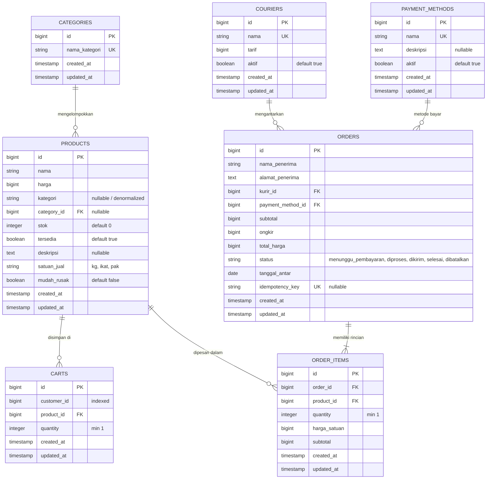

# AgriMart (TokoTani) Database Schema Specification

Dokumen ini menjelaskan struktur skema basis data MySQL/SQLite untuk backend aplikasi **AgriMart** (TokoTani), hubungan antar entitas (relasi Eloquent), serta aturan integritas data (*business invariants*).

---

## 1. Diagram Relasi Entitas (ERD)

---

## 2. Rincian Definisi Tabel

### 1. Tabel `categories`
Menyimpan klasifikasi produk pertanian (misalnya Sayuran, Buah-buahan, Sembako, Pupuk & Bibit).
- `id` (BIGINT, UNSIGNED, AUTO_INCREMENT, PRIMARY KEY)
- `nama_kategori` (VARCHAR(255), UNIQUE, NOT NULL)
- `created_at`, `updated_at` (TIMESTAMP)

### 2. Tabel `products`
Menyimpan katalog produk pertanian yang dijual.
- `id` (BIGINT, UNSIGNED, AUTO_INCREMENT, PRIMARY KEY)
- `nama` (VARCHAR(255), NOT NULL)
- `harga` (BIGINT, UNSIGNED, NOT NULL): Harga jual satuan dalam Rupiah.
- `kategori` (VARCHAR(255), NULLABLE): Nama kategori produk (denormalisasi untuk performa pencarian).
- `category_id` (BIGINT, UNSIGNED, NULLABLE, FK -> `categories.id` ON DELETE SET NULL)
- `stok` (INT, UNSIGNED, NOT NULL, DEFAULT 0): Jumlah kuantitas stok fisik tersedia.
- `tersedia` (BOOLEAN, NOT NULL, DEFAULT TRUE): Status ketersediaan produk untuk dibeli.
- `deskripsi` (TEXT, NULLABLE): Deskripsi lengkap produk.
- `satuan_jual` (VARCHAR(50), NOT NULL): Satuan pengukuran (misal: `kg`, `ikat`, `pak 5kg`, `liter`).
- `mudah_rusak` (BOOLEAN, NOT NULL, DEFAULT FALSE): Penanda apakah produk harus dikirim pada hari yang sama (*same-day delivery*).
- `created_at`, `updated_at` (TIMESTAMP)

### 3. Tabel `carts`
Menyimpan keranjang belanja pelanggan secara persisten di server (*Server-side Single Source of Truth*).
- `id` (BIGINT, UNSIGNED, AUTO_INCREMENT, PRIMARY KEY)
- `customer_id` (BIGINT, UNSIGNED, NOT NULL, INDEX, DEFAULT 1): ID pelanggan pemilik keranjang.
- `product_id` (BIGINT, UNSIGNED, NOT NULL, FK -> `products.id` ON DELETE CASCADE)
- `quantity` (INT, UNSIGNED, NOT NULL, DEFAULT 1): Jumlah item yang ingin dibeli.
- `created_at`, `updated_at` (TIMESTAMP)
- **Constraint Unik:** `UNIQUE(customer_id, product_id)` memastikan tidak terjadi duplikasi baris untuk produk yang sama pada satu pelanggan.

### 4. Tabel `couriers`
Menyimpan data kurir ekspedisi dan tarif pengiriman.
- `id` (BIGINT, UNSIGNED, AUTO_INCREMENT, PRIMARY KEY)
- `nama` (VARCHAR(255), UNIQUE, NOT NULL)
- `tarif` (BIGINT, UNSIGNED, NOT NULL): Biaya ongkos kirim dalam Rupiah.
- `aktif` (BOOLEAN, NOT NULL, DEFAULT TRUE): Status keaktifan layanan kurir.
- `created_at`, `updated_at` (TIMESTAMP)

### 5. Tabel `payment_methods`
Menyimpan kanal pembayaran yang didukung (Transfer Bank, QRIS, COD).
- `id` (BIGINT, UNSIGNED, AUTO_INCREMENT, PRIMARY KEY)
- `nama` (VARCHAR(255), UNIQUE, NOT NULL)
- `deskripsi` (TEXT, NULLABLE)
- `aktif` (BOOLEAN, NOT NULL, DEFAULT TRUE): Status keaktifan metode pembayaran.
- `created_at`, `updated_at` (TIMESTAMP)

### 6. Tabel `orders`
Menyimpan transaksi pesanan induk.
- `id` (BIGINT, UNSIGNED, AUTO_INCREMENT, PRIMARY KEY)
- `nama_penerima` (VARCHAR(255), NOT NULL)
- `alamat_penerima` (TEXT, NOT NULL)
- `kurir_id` (BIGINT, UNSIGNED, NOT NULL, FK -> `couriers.id` ON DELETE RESTRICT)
- `payment_method_id` (BIGINT, UNSIGNED, NOT NULL, FK -> `payment_methods.id` ON DELETE RESTRICT)
- `subtotal` (BIGINT, UNSIGNED, NOT NULL): Total harga seluruh barang pesanan.
- `ongkir` (BIGINT, UNSIGNED, NOT NULL): Tarif kurir yang dipilih.
- `total_harga` (BIGINT, UNSIGNED, NOT NULL): `subtotal + ongkir`.
- `status` (VARCHAR(50), NOT NULL, DEFAULT 'menunggu_pembayaran'): Status pesanan (`menunggu_pembayaran`, `diproses`, `dikirim`, `selesai`, `dibatalkan`).
- `tanggal_antar` (DATE, NOT NULL): Tanggal estimasi pengantaran pesanan.
- `idempotency_key` (VARCHAR(255), UNIQUE, NULLABLE): Kunci unik untuk menjamin idempotensi checkout.
- `created_at`, `updated_at` (TIMESTAMP)

### 7. Tabel `order_items`
Menyimpan rincian produk pada tiap transaksi pesanan.
- `id` (BIGINT, UNSIGNED, AUTO_INCREMENT, PRIMARY KEY)
- `order_id` (BIGINT, UNSIGNED, NOT NULL, FK -> `orders.id` ON DELETE CASCADE)
- `product_id` (BIGINT, UNSIGNED, NOT NULL, FK -> `products.id` ON DELETE RESTRICT)
- `quantity` (INT, UNSIGNED, NOT NULL, DEFAULT 1)
- `harga_satuan` (BIGINT, UNSIGNED, NOT NULL): Snapshot harga produk saat dipesan.
- `subtotal` (BIGINT, UNSIGNED, NOT NULL): `quantity * harga_satuan`.
- `created_at`, `updated_at` (TIMESTAMP)
- **Constraint Unik:** `UNIQUE(order_id, product_id)`

---

## 3. Aturan Integritas Data & Model Hooks (Invariants)

1. **Pengurangan Stok Otomatis:**
   Ketika pesanan dibuat melalui `/api/checkout`, pemotongan stok dilakukan di dalam transaksi database atomik (`DB::transaction`). Baris produk dikunci dengan `lockForUpdate()` dengan urutan terurut `sortBy('product_id')` untuk mencegah *race condition* dan *deadlock*.
2. **Ketersediaan Produk Otomatis:**
   Pada model `Product::booted()`, jika `stok <= 0`, kolom `tersedia` otomatis disetel ke `false`.
3. **Pengembalian Stok Saat Pembatalan:**
   Pada model `Order::booted()`, jika status pesanan diubah menjadi `dibatalkan` (misal oleh admin via Filament atau sistem), seluruh stok item pesanan dikembalikan (*restored/incremented*) ke produk bersangkutan. Jika stok kembali di atas 0, `tersedia` otomatis diaktifkan kembali.
4. **Proteksi Integritas Relasi Hapus (HTTP 409):**
   Produk tidak dapat dihapus jika masih terdapat pesanan aktif yang menggunakannya atau memiliki riwayat transaksi berintegritas keuangan.
5. **Pembersihan Keranjang Otomatis:**
   Setelah checkout berhasil dibuat, item-item yang dibeli otomatis dihapus dari tabel `carts` milik pelanggan bersangkutan.

