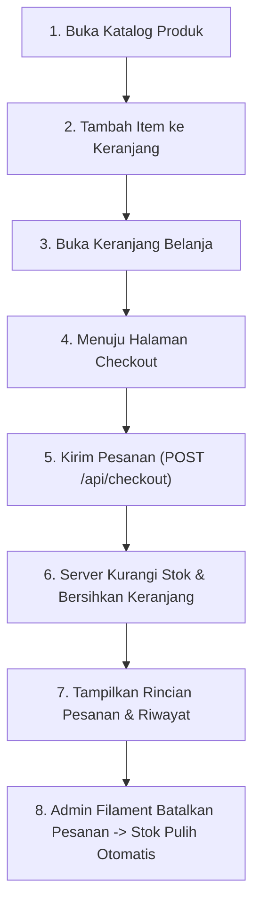

# AgriMart (TokoTani) Fullstack Integration Guide

Panduan lengkap untuk menjalankan, mengintegrasikan, dan memverifikasi sistem backend Laravel dan aplikasi mobile Flutter **AgriMart** (TokoTani) secara *end-to-end*.

---

## 1. Prasyarat Sistem

- **PHP:** Versi 8.2 atau lebih baru (disarankan PHP 8.3)
- **Composer:** Versi 2.x
- **Database:** MySQL 8.x / MariaDB atau SQLite (untuk pengujian otomatis)
- **Web Server:** Built-in PHP CLI Server atau Apache/Nginx
- **Flutter SDK:** Versi 3.x (disertai Dart SDK 3.x)
- **Target Perangkat:** Android Emulator, Perangkat Fisik Android, atau Windows/Chrome Desktop

---

## 2. Langkah Menjalankan Backend Laravel

### A. Konfigurasi Lingkungan
1. Buka terminal pada folder backend:
   ```bash
   cd TokoTani_Backend
   ```
2. Pastikan file `.env` sudah ada dan terisi konfigurasi database:
   ```env
   APP_NAME=TokoTani
   APP_ENV=local
   APP_KEY=base64:d7VKD3aIkJ7EaW8OaBXhkO6nI7Hzy0zd4pcWZfY03nw=
   APP_DEBUG=true
   APP_URL=http://localhost:8000

   DB_CONNECTION=mysql
   DB_HOST=127.0.0.1
   DB_PORT=3306
   DB_DATABASE=tokotani
   DB_USERNAME=root
   DB_PASSWORD=
   ```
3. Jika database `tokotani` belum dibuat di MySQL, buat database tersebut terlebih dahulu:
   ```sql
   CREATE DATABASE tokotani CHARACTER SET utf8mb4 COLLATE utf8mb4_unicode_ci;
   ```

### B. Migrasi Skema Basis Data
Jalankan migrasi untuk membuat seluruh tabel (termasuk tabel `carts`, `products`, `orders`, `order_items`, `couriers`, dan `payment_methods`):
```bash
php artisan migrate
```

### C. Menjalankan Server Backend
> [!IMPORTANT]
> Sangat disarankan mengikat server ke host `0.0.0.0` agar server dapat dijangkau oleh emulator Android (`10.0.2.2`), perangkat fisik pada jaringan Wi-Fi lokal, serta browser host.

Jalankan perintah:
```bash
php artisan serve --host=0.0.0.0 --port=8000
```
Server aktif pada `http://127.0.0.1:8000` (atau port 8000 pada alamat IP lokal Anda).

### D. Akses Panel Admin Filament
Untuk mengelola produk, kategori, kurir, dan memantau status pesanan dari web:
1. Akses browser pada: `http://localhost:8000/admin`
2. Masuk menggunakan akun admin. Jika ingin mengganti kata sandi admin atau membuat admin baru, jalankan:
   ```bash
   php artisan app:admin-password
   ```

---

## 3. Langkah Menjalankan Aplikasi Flutter

### A. Pengaturan Dependensi
Buka terminal pada folder Flutter:
```bash
cd TokoTani_Frontend
flutter pub get
```

### B. Konfigurasi Jaringan & Alamat API (Single Source of Truth)
Aplikasi telah dilengkapi deteksi platform terpusat di `lib/core/config/api_config.dart`.
Secara otomatis:
- **Emulator Android:** Menghubungi `http://10.0.2.2:8000/api`
- **Windows Desktop / Chrome Web:** Menghubungi `http://127.0.0.1:8000/api`
- **Perangkat Fisik (HP Android via Wi-Fi):**
  Buka file `lib/core/config/api_config.dart` dan masukkan IP lokal komputer pengembang:
  ```dart
  static String physicalDeviceBaseUrl = 'http://192.168.1.10:8000/api';
  ```
  atau cukup atur `ApiConfig.customBaseUrl`:
  ```dart
  ApiConfig.customBaseUrl = 'http://192.168.1.10:8000/api';
  ```

> [!NOTE]
> Nilai `ApiService.useMock` telah disetel ke `false` secara default sehingga seluruh data diambil langsung dari database Laravel sebagai *Single Source of Truth*.

### C. Menjalankan Aplikasi
Pilih target perangkat yang diinginkan:
```bash
# Menjalankan di Android Emulator atau HP fisik
flutter run

# Menjalankan di Windows Desktop (untuk pengujian cepat tanpa emulator)
flutter run -d windows

# Menjalankan di Google Chrome Web
flutter run -d chrome
```

---

## 4. Verifikasi Alur Terintegrasi (*End-to-End*)

Lakukan pengujian alur bisnis berikut untuk memastikan sinkronisasi berjalan sempurna:



1. **Katalog Produk:**
   Buka halaman utama / katalog. Produk yang muncul adalah data aktual dari database MySQL (`GET /api/produk`). Uji filter kategori dan pencarian nama.
2. **Tambah ke Keranjang:**
   Buka detail produk, pilih jumlah kuantitas, lalu tekan *Tambah ke Keranjang* (`POST /api/keranjang`). Jika kuantitas melebihi stok yang ada, server akan mengembalikan peringatan HTTP 409 (*Stok tidak mencukupi*).
3. **Keranjang Belanja:**
   Buka tab keranjang. Daftar item dan nilai **Subtotal** murni diambil dari kalkulasi server database (`GET /api/keranjang`). Ubah jumlah item (`PUT /api/keranjang/{id}`) atau hapus item (`DELETE /api/keranjang/{id}`).
4. **Checkout Transaksi:**
   Tekan *Checkout*, pilih kurir pengiriman dan metode pembayaran (`GET /api/kurir`, `GET /api/metode-pembayaran`).
   - *Pengujian Aturan Mudah Rusak:* Jika keranjang berisi barang seperti sayuran/cabai (`mudah_rusak = true`), tanggal antar dibatasi hanya untuk hari ini (*Same-day*). Jika memilih tanggal masa depan, sistem validasi akan menolak.
5. **Konfirmasi Pesanan:**
   Tekan *Buat Pesanan*. Transaksi dieksekusi secara atomik (`POST /api/checkout`).
   - Stok produk di database otomatis berkurang.
   - Item yang dipesan otomatis terhapus dari keranjang belanja.
   - Layar langsung diarahkan ke halaman rincian pesanan.
6. **Riwayat Pesanan:**
   Buka halaman riwayat pesanan (`GET /api/pesanan`). Pesanan yang baru dibuat tampil pada urutan teratas dengan status `menunggu_pembayaran`.
7. **Sinkronisasi Balik via Admin Filament:**
   Buka panel admin web `http://localhost:8000/admin`. Buka menu *Orders*, ubah status pesanan menjadi `dibatalkan`. Periksa tabel *Products*: stok produk bertambah kembali secara otomatis sesuai jumlah yang sebelumnya dipesan.

